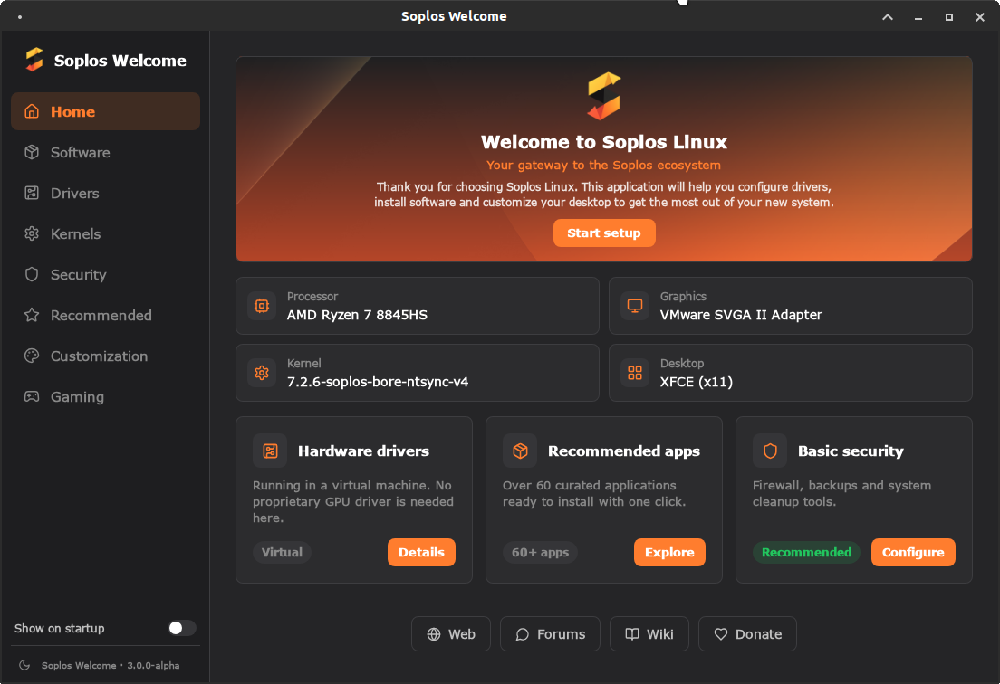
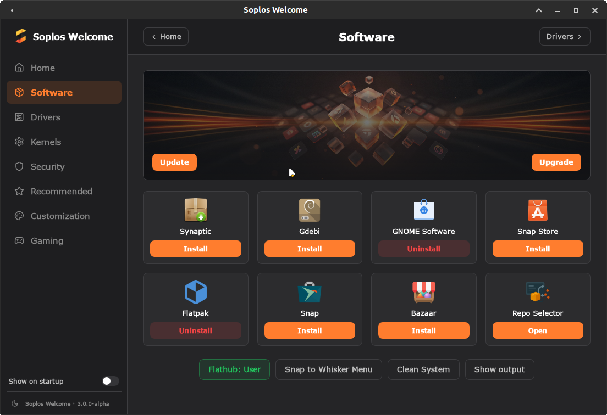
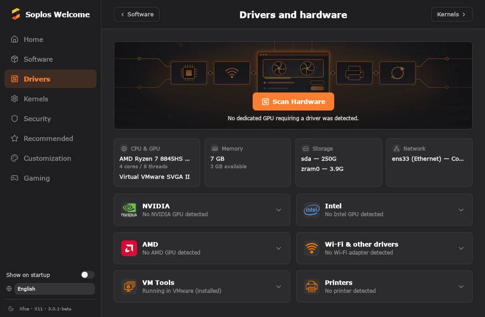
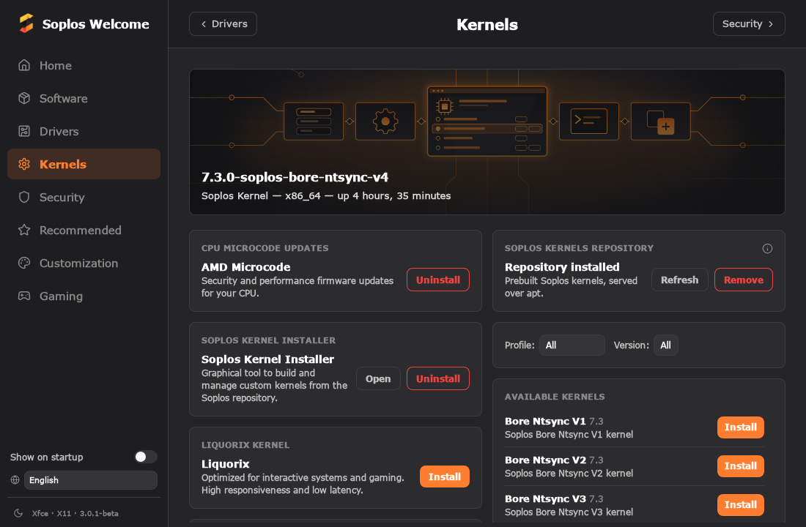
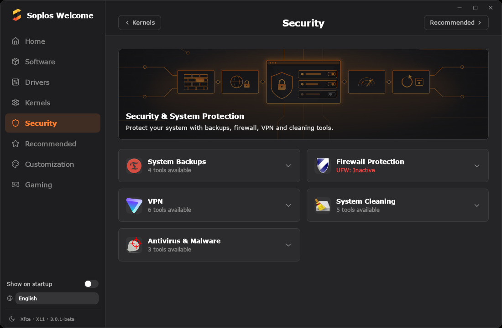
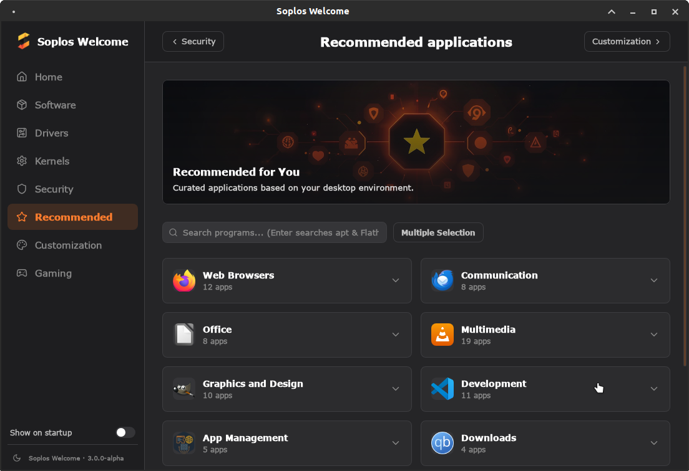
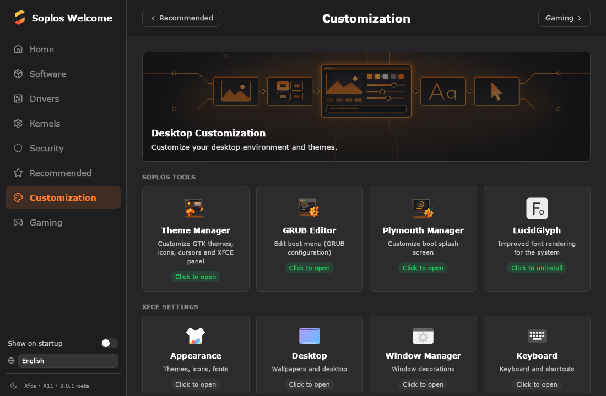
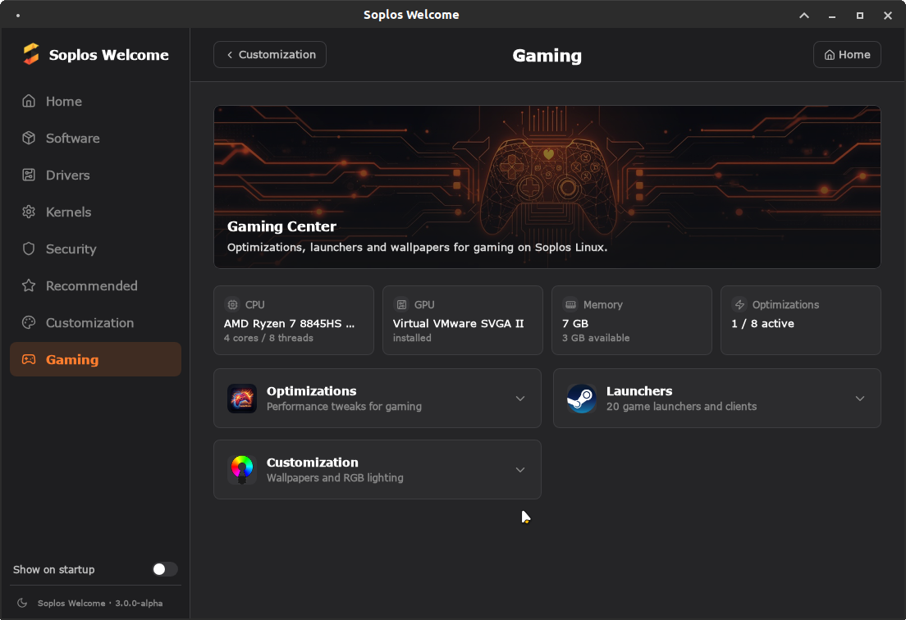

# Soplos Welcome 3.0


Welcome and system setup application for Soplos Linux.

It gives you one place to update the system, install drivers and kernels, harden security, pick applications, tune the desktop and optimize the machine for gaming.

## Screenshots

| | |
|---|---|
|  **Home**: system overview, quick links and session environment status |  **Software**: APT, Flatpak, Snap, Flathub and system cleanup |
|  **Drivers**: hardware detection, GPU drivers (NVIDIA/CUDA/ROCm/oneAPI) and Wi-Fi |  **Kernels**: Soplos Kernels repository, Liquorix, XanMod and kernel cleanup |
|  **Security**: UFW firewall, ClamAV antivirus, rkhunter scans and network tools |  **Recommended**: curated applications across 13 categories with bulk selection |
|  **Customization**: desktop tools for Xfce, GNOME and KDE, wallpapers and fonts |  **Gaming**: launchers, game mode, sysctl optimizations and MangoHud |

## Architecture

Version 3.0 is a ground-up rewrite of Soplos Welcome. The original app was written in Python 3 with GTK3 (PyGObject). This rewrite replaces that entire stack with Tauri 2: a Rust backend and a Svelte 4 + Tailwind CSS frontend, rendered through the system's WebKitGTK.

- **Backend** (`src-tauri/`): one Rust module per section (`software.rs`, `drivers.rs`, `kernels.rs`, `security.rs`, `recommended.rs`, `customization.rs`, `gaming.rs`). Actions that need administrator rights run through `pkexec`, never as a long-lived root process; the privileged script itself is written to a temporary file and the same binary re-invokes itself to run it, rather than shelling out arbitrary strings. Long-running commands stream their output back to the interface through a job runner instead of blocking the UI.
- **Frontend** (`src/`): one Svelte view per section, shared components (popups, the flatpak-scope choice, the language switcher), and the 8-language dictionaries under `src/i18n/`.
- **Privileges**: administrator tasks invoke `/usr/share/polkit-1/actions/org.soplos.welcome.policy` via `pkexec`.
- **Autostart**: the session autostart entry is created or removed from the application, as `~/.config/autostart/org.soplos.welcome.desktop`.

## Installation

Soplos Welcome comes preinstalled on Soplos Linux. If you need to install it manually:

```bash
sudo apt install soplos-welcome
```

## Sections

- **Home**: system overview, hardware specs, display server detection (X11 / Wayland), desktop environment, and quick action shortcuts.
- **Software**: APT package manager, Flatpak (user, system or both scopes), Snap and Flathub management, system update and upgrade, and Flatpak runtime cleanup.
- **Drivers**: hardware detection with NVIDIA proprietary drivers, CUDA toolkit, AMD ROCm, Intel oneAPI, Broadcom / MediaTek Wi-Fi firmware, and VirtualBox guest additions.
- **Kernels**: Soplos Kernels repository, XanMod and Liquorix kernels, kernel cleanup for removing old unused kernels, and integration with Soplos Kernel Installer.
- **Security**: firewall management (UFW), antivirus scans (ClamAV), rootkit detection (rkhunter), VPN configuration, and system hardening checks.
- **Recommended**: about 100 curated applications across 13 categories, single or multiple selection for batch install/uninstall, and extended search.
- **Customization**: desktop personalization tools for Xfce, GNOME and KDE Plasma, wallpaper manager, and font rendering presets.
- **Gaming**: game launchers (Steam, Heroic, Lutris, Bottles), GameMode configuration, low-latency sysctl tuning, GPU optimizations, and MangoHud overlay setup.

## Keyboard shortcuts

| Shortcut | Action |
|---|---|
| F1 | Open About dialog |
| Ctrl+Q | Quit application |
| Ctrl+Tab | Next section |
| Ctrl+Shift+Tab | Previous section |

## Documentation

A Unix manual page is included and installed with the package:

```bash
man soplos-welcome
```

## Languages

The interface is available in 8 languages: English, Español, Deutsch, Français, Italiano, Português, Română and Русский. It starts in the system language and falls back to English. The language can be changed at any time from the sidebar.

## Building

```bash
npm install
npm run tauri dev      # development
./package.sh           # builds the .deb and moves it to ~/Descargas/SoplosApps
```

## License

Copyright © 2026 Sergi Perich <info@soploslinux.com>. Published under the GPL-3.0-or-later license. See `LICENSE`.
